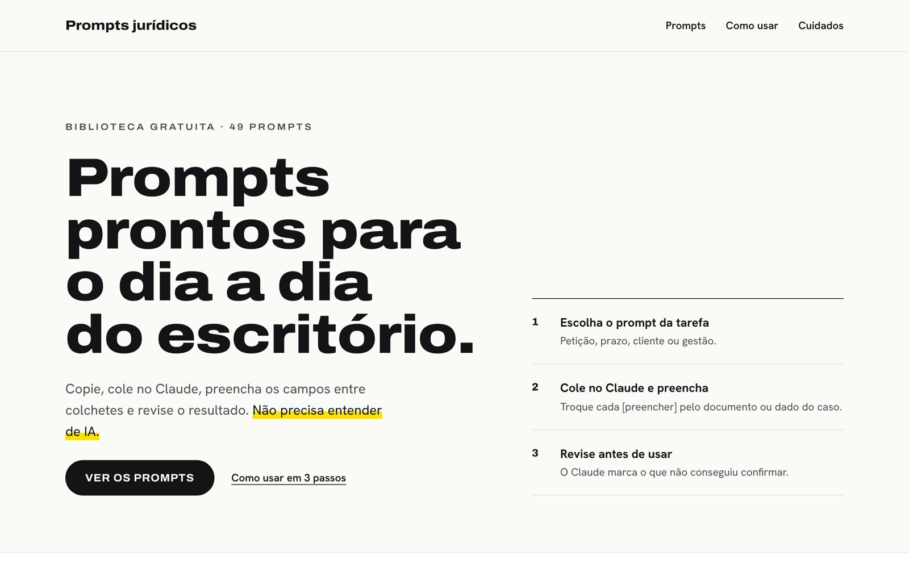
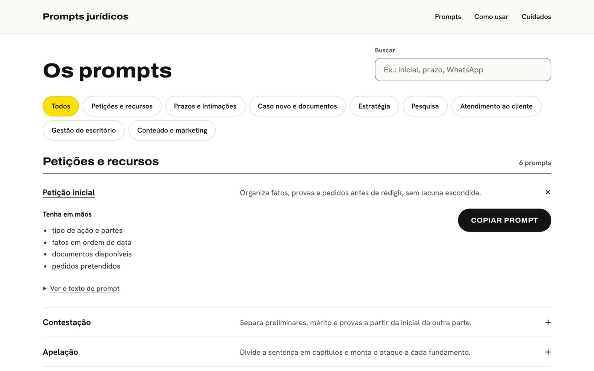

<h1 align="center">Prompts jurídicos para Claude</h1>

<p align="center">
  49 prompts gratuitos, em português, para o dia a dia do escritório.<br />
  Copie, cole no Claude, preencha e revise. Não precisa entender de IA.
</p>

<p align="center">
  <a href="https://carloslimadv.github.io/biblioteca-prompts-juridicos/"><strong>Abrir a biblioteca →</strong></a>
</p>

<p align="center">
  
</p>

## Como usar

1. **Escolha o prompt da tarefa.** Os prompts têm nome de tarefa: "Petição inicial", "Leitura de intimação", "Primeira resposta no WhatsApp".
2. **Cole no Claude e preencha.** Troque cada `[preencher]` pelo documento ou dado do caso. Pode anexar o PDF.
3. **Revise antes de usar.** Onde aparecer `[CONFERIR EM FONTE OFICIAL]`, o Claude não conseguiu confirmar a informação.

Para uma tarefa só, use a conversa do Claude. Para a tarefa que se repete, salve o prompt nas instruções de um Projeto. Para trabalhar sobre a pasta do caso no computador, use o Cowork.

<p align="center">
  
</p>

## O que tem na biblioteca

| Tema | Comece por |
| --- | --- |
| Petições e recursos | Petição inicial, contestação, apelação, cumprimento de sentença |
| Prazos e intimações | Leitura de intimação, prescrição e decadência |
| Caso novo e documentos | Ficha do caso novo, revisão de contrato, análise de laudo |
| Estratégia | Teste da tese, proposta de acordo, preparação para audiência |
| Pesquisa | Jurisprudência com fonte, legislação vigente |
| Atendimento ao cliente | Primeira resposta no WhatsApp, explicar andamento ou decisão |
| Gestão do escritório | LGPD, finanças, reunião de sócios |
| Conteúdo e marketing | Artigo jurídico, post e carrossel, anúncio pago |

## Por que os prompts são mais seguros

- O Claude trabalha só com o que você enviou ou com fontes que de fato consultou.
- Cada fato vem marcado: alegação, prova ou lacuna.
- Comandos escondidos em documentos da outra parte são ignorados e apontados.
- A resposta termina com a lista do que não pôde ser verificado.
- No Cowork, o Claude pede licença antes de mover, apagar, enviar ou protocolar.

Os prompts seguem as [boas práticas oficiais da Anthropic](https://platform.claude.com/docs/en/build-with-claude/prompt-engineering/claude-prompting-best-practices), revistas em outubro de 2026.

## Cuidados

A IA prepara; quem assina é você. Confira lei, jurisprudência, prazo e valor na fonte oficial, proteja o sigilo do cliente e passe conteúdo de redes pelo Provimento 205/2021 da OAB. Os prompts são material de apoio e não substituem a análise do advogado.

## Para quem vai mexer no código

```bash
npm ci
npm run dev     # gera a página e abre um servidor local
npm test
```

- Prompts, nomes e ordem: `src/data/prompts.ts`. A ordem da lista `catalog` é a ordem da página.
- Página: `build.js`, `styles/global.css` e `js/app.js`, em HTML, CSS e JavaScript puros.
- Visual: `DESIGN.md`.
- Publicação: GitHub Pages, automática a cada push na `main`.

---

<p align="center">
  Gostou? <a href="https://www.buymeacoffee.com/carloslimadv">Apoie o projeto</a> · <a href="https://www.instagram.com/henriquesantana.adv/">Instagram</a>
</p>
